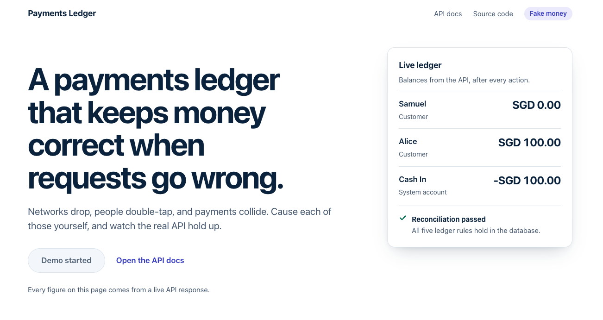
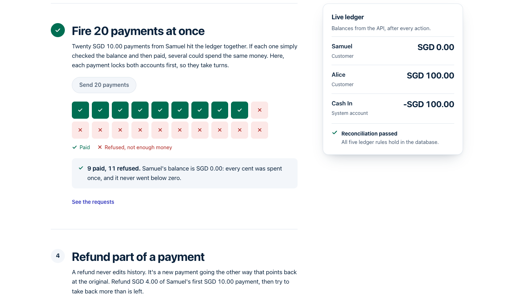

# Payments Ledger Service

A double-entry payments ledger built with **Kotlin** and **Spring Boot 4**, backed by **PostgreSQL**.
It handles accounts, money transfers, refunds and card-style holds (authorize now, capture or release
later), and it stays correct under concurrent requests and client retries.

I built it as a learning project to understand how real payment systems keep money correct: not just
the happy path, but races, retries, refunds and data that drifts.



The demo page lets you cause the failures yourself. Here, 20 SGD 10.00 payments hit an account holding
SGD 90.00 at once: 9 are paid, 11 are refused, and the balance stops at exactly zero.



## Features

- **Accounts**: customer accounts, plus system accounts that represent money entering the ledger
- **Transfers** between accounts, recorded with double-entry bookkeeping
- **Idempotent writes**: retrying a request with the same `Idempotency-Key` never moves money twice
- **Refunds**: full and partial reversals, never more than the original amount
- **Holds**: reserve money now, then capture (fully or partially) or release it later
- **Balance and available balance** for every account
- **Transaction history** per account, with cursor-based pagination
- **Reconciliation endpoint** that checks the whole ledger against its rules
- **API docs** (OpenAPI / Swagger UI), **metrics** (Micrometer) and **logs**
- **Live demo page** that walks through retries, races, refunds and holds against the real API
- Runs with one command using **Docker Compose**

## Tech stack

Kotlin 2.3 · JDK 21 · Spring Boot 4.1 (Web MVC, JDBC, Validation, Actuator) · PostgreSQL 16 ·
`JdbcTemplate` with plain SQL (no ORM) · Flyway · JUnit 5 + Testcontainers + MockMvc · springdoc-openapi ·
Micrometer · Docker · GitHub Actions

## Key design decisions

### Money is stored as whole numbers of minor units

Amounts are `Long` in Kotlin and `BIGINT` in Postgres, in the smallest unit of the currency:
`1050` means SGD 10.50. `Double` can't represent most decimals exactly (`0.1 + 0.2` is not `0.3`), and
those tiny errors add up until the ledger no longer balances. `BigDecimal` is exact, but it has
surprises of its own (`BigDecimal("10.5") != BigDecimal("10.50")`). Whole numbers of cents are exact,
fast and simple to compare.

### Double-entry bookkeeping

Money is never created or destroyed, only moved. Every transfer writes **two entries**: `-amount` on
the account the money leaves and `+amount` on the account it goes to. So every transfer sums to zero,
and the **whole ledger always sums to zero**. If it ever doesn't, something is wrong, and the
reconciliation endpoint will say so.

Money enters the ledger through **system accounts** (for example a "cash-in" account), which are allowed
to go negative. Their negative balance is a record of how much outside money has come in.

### Balances are computed, not stored

There is no `balance` column. An account's balance is `SUM(entries.amount)`. With a stored balance,
the column and the entries could disagree after a bug, and there'd be no way to tell which is right.
With a computed balance, the entries are the only source of truth and the balance can't drift from
them. The trade-off is a `SUM` per read, kept fast by an index on `entries (account_id, id)`.

### Row locking, in a fixed order

Two transfers from the same account at the same moment could both read the balance before either one
writes, and both pass the funds check, overdrawing the account. Every money movement therefore runs in
one database transaction that first locks both accounts with `SELECT ... FOR UPDATE`, and **only then**
reads the balance. Transfers touching the same account take turns.

The accounts are always locked **in id order** (`ORDER BY id`). Without that, a transfer from A to B
and one from B to A could each lock one account and wait forever for the other (a deadlock).

The lock is only useful inside a transaction: outside one, it would be released as soon as the
`SELECT` finished. So `@Transactional` sits on the public service methods the controllers call.

### Idempotency keys

Clients retry when a request times out, and they can't tell whether the first attempt went through.
Every money-moving `POST` requires an `Idempotency-Key` header, stored on the transfer itself
(a `UNIQUE` column):

- new key: process normally and save the key with the transfer
- same key, same request: return the **original** result (same id, same status code), move no money
- same key, different request: `422`

The key lookup happens **after** the account lock. A concurrent retry waits on the lock, and when it
gets it, the first request has committed, so the lookup finds it and returns the original transfer.
The `UNIQUE` constraint is the database-level safety net for the case the lock can't cover (the same
key used for different accounts at the same moment).

### Append-only ledger and reversals

Transfers and entries are **never updated or deleted**: they are the audit trail. A refund is a **new
transfer in the opposite direction** that points at the original (`reverses_transfer_id`). Partial
refunds are allowed, but never more than the original amount in total, and a reversal can't itself be
reversed.

"Total refunds ≤ original" spans many rows, so a `CHECK` constraint can't enforce it. The service
enforces it instead, and the existing account lock protects it: every refund of a transfer involves
the same two accounts, so concurrent refunds take turns, and each one reads the refunded-so-far sum
after the lock.

### Holds and available balance

A hold reserves money without moving it, like a hotel putting a hold on a card. Each account has two
numbers:

- **balance** = sum of entries (money that has actually moved)
- **available** = balance minus the account's `ACTIVE` holds (money that can still be spent)

Overdraft checks use **available**, so a held amount can't be spent elsewhere and a capture is
guaranteed to succeed. A hold is a promise, not money, so its status is updated in place:
`ACTIVE → CAPTURED` or `ACTIVE → RELEASED`, each final. Capturing creates an ordinary transfer; a
partial capture just captures less, and the rest is freed because the hold is no longer `ACTIVE`.

Some details that matter:

- capture marks the hold `CAPTURED` **before** moving the money, so the hold isn't counted twice by
  the funds check; both happen in one transaction, so a failure rolls back the status too
- capture and release lock the **hold row** first, so they can't both succeed on the same hold
- every operation that needs both locks takes the hold first and the accounts second, so there's no
  lock cycle and no deadlock
- each capture transfer uses the idempotency key `capture:<holdId>`, so the `UNIQUE` constraint makes
  two captures of one hold impossible at the database level
- a **partial index** on `holds (from_account_id) WHERE status = 'ACTIVE'` keeps the available-balance
  query fast however many old holds pile up

### Cursor pagination for history

`GET /accounts/{id}/entries` uses a cursor (`?before=<entryId>`) instead of page numbers. With offset
paging, new entries arriving at the top shift every page and cause duplicates; a cursor points at a row,
so pages stay stable. The query fetches `limit + 1` rows to know whether there's a next page without a
`COUNT`, and the composite index `(account_id, id)` lets Postgres read one page in a single backward
index scan, at the same cost however long the history is.

### Reconciliation

Tests prove the code, but not that nothing else ever touched the data (a manual `UPDATE`, a bug in an
untested path, a broken deploy). `GET /admin/reconciliation` checks the actual rows against the
ledger's rules, one SQL query per rule, each returning the rows that break it:

1. all entries sum to zero
2. every transfer has exactly one `-amount` entry on its sender and one `+amount` entry on its receiver
3. no transfer is reversed by more than its amount, and no reversal is reversed
4. every captured hold has exactly one capture transfer, and other holds have none
5. no customer account has a negative balance or available balance

Problems are returned as readable messages (and logged as a warning).

### Metrics count real changes only

Two counters, `ledger.transfers.created` (tagged `type`: transfer, reversal, capture) and `ledger.holds`
(tagged `outcome`: created, captured, released), go up only at the point where a new row is actually
written. Idempotent replays return earlier and are never counted, so a client retrying five times
doesn't look like five transfers.

## Running it

**Requirements:** Docker. For local development, also JDK 21.

### Everything in Docker

```bash
docker compose up --build
```

This starts PostgreSQL and the service. The app waits until Postgres passes its health check, then runs
the database migrations on startup.

- Live demo: http://localhost:8080/
- Health: http://localhost:8080/actuator/health
- Swagger UI: http://localhost:8080/swagger-ui/index.html

Stop with `docker compose down` (add `-v` to also delete the database volume).

### Local development

```bash
docker compose up -d postgres   # only the database, on localhost:5434
./gradlew bootRun               # the service, on localhost:8080
```

### Tests

```bash
./gradlew build
```

The tests start their own PostgreSQL container with Testcontainers, so Docker must be running.

## API overview

Full details, request and response shapes are in **Swagger UI** at `/swagger-ui/index.html`
(the raw OpenAPI document is at `/v3/api-docs`).

| Method | Path | Description |
|---|---|---|
| `POST` | `/accounts` | Create an account (`CUSTOMER` or `SYSTEM`) |
| `GET` | `/accounts/{id}` | Get an account |
| `GET` | `/accounts/{id}/balance` | Balance and available balance |
| `GET` | `/accounts/{id}/entries?limit=&before=` | Transaction history, newest first |
| `POST` | `/transfers` | Move money (requires `Idempotency-Key`) |
| `GET` | `/transfers/{id}` | Get a transfer |
| `POST` | `/transfers/{id}/reversals` | Refund all or part of a transfer (requires `Idempotency-Key`) |
| `POST` | `/holds` | Reserve money (requires `Idempotency-Key`) |
| `GET` | `/holds/{id}` | Get a hold |
| `POST` | `/holds/{id}/capture` | Capture all or part of a hold |
| `POST` | `/holds/{id}/release` | Release a hold |
| `GET` | `/admin/reconciliation` | Check the ledger against its rules |
| `GET` | `/actuator/health`, `/actuator/metrics` | Health and metrics |

Errors use standard status codes: `400` for invalid requests, `404` for unknown resources, and `422`
(with an RFC 9457 ProblemDetail body) when a request is valid but breaks a business rule, such as
insufficient funds.

### Example

```bash
# Create a system account (where money enters) and a customer account; note each "id"
curl -s -X POST localhost:8080/accounts -H 'Content-Type: application/json' \
  -d '{"ownerName":"Cash In","currency":"SGD","kind":"SYSTEM"}'
curl -s -X POST localhost:8080/accounts -H 'Content-Type: application/json' \
  -d '{"ownerName":"Samuel","currency":"SGD","kind":"CUSTOMER"}'

# Fund Samuel with SGD 100.00 (10000 cents)
curl -s -X POST localhost:8080/transfers -H 'Content-Type: application/json' \
  -H 'Idempotency-Key: fund-samuel-1' \
  -d '{"fromAccountId":"<cashInId>","toAccountId":"<samuelId>","amount":10000,"currency":"SGD"}'

# Check his balance
curl -s localhost:8080/accounts/<samuelId>/balance
```

## How it's tested

- **Integration tests against real PostgreSQL** (Testcontainers), driven through the HTTP API with
  MockMvc, so SQL, constraints, transactions and locks are all exercised for real.
- Tests check **outcomes, not just status codes**: after a rejected overdraft or refund, balances are checked
  to prove nothing moved.
- **Concurrency tests** release many threads at the same instant (a start-gate latch), for example:
  20 transfers from one account (never overdrawn), 10 identical retries (one transfer), 10 partial
  refunds (never more than the original), concurrent capture and release of one hold (only one wins),
  and 10 holds at once (never more than available).
- The key protections were **proven necessary** by removing each one and watching the matching test fail
  (for example, deleting `FOR UPDATE` makes the overdraft test fail).
- The reconciliation test corrupts the ledger on purpose inside a rolled-back transaction, so the shared
  test database stays clean.
- **CI** (GitHub Actions) runs the full build and tests, then builds the Docker image, so a broken
  Dockerfile fails the build too.

## Project structure

```
src/main/kotlin/dev/samueltan/ledger/
  account/    accounts, balances, history
  transfer/   transfers, reversals, the shared moveMoney logic
  hold/       holds: create, capture, release
  admin/      reconciliation
  common/     errors (ProblemDetail) shared by all features
src/main/resources/db/migration/   Flyway migrations V1–V6
src/main/resources/static/         the demo page (one HTML file, no build step)
```

## Limitations and next steps

This is a learning project, and these are known gaps:

- **No authentication.** Anyone who can reach the service can call every endpoint, including
  `/admin/reconciliation` and the metrics.
- **One currency per transfer.** No currency conversion.
- **Holds never expire.** A real system would release them automatically after some time.
- **Reconciliation runs on demand**, not on a schedule, and only checks internal consistency (not
  against bank statements).
- **Metrics and logs are emitted just before commit**, so a rare commit failure could count a transfer
  that was rolled back.
- **Client idempotency keys share a column with server-generated `capture:` keys.** Clients are blocked
  from that prefix, but a real system would keep them apart.
- Validation errors (`400`) don't use the ProblemDetail format yet, and some `404`s have an empty body.

Possible next steps: authentication and an admin role, scheduled reconciliation, hold expiry, separate
key namespaces, after-commit metrics, consistent ProblemDetail errors, and publishing the Docker image
from CI.
